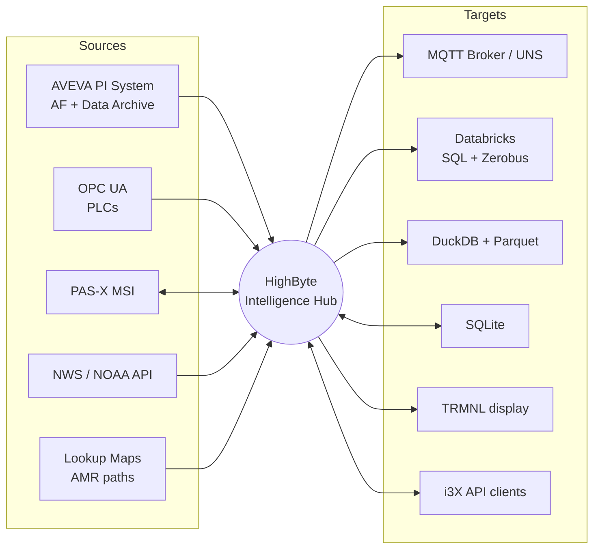

# HighBytePublic

Example project exports for **HighByte® Intelligence Hub** — Industrial DataOps pipelines covering AVEVA PI System, MQTT / Unified Namespace (UNS), Databricks, DuckDB, OPC UA, the i3X API, Werum PAS-X MSI, and a couple of fun weather demos.

Each `intelligencehub-deployment_*.json` file is a self-contained, tagged Intelligence Hub project export that can be imported on its own.

| | |
|---|---|
| **Projects** | 9 |
| **Pipelines** | 33 |
| **Exported from** | Intelligence Hub 4.5.2 – 4.5.6 (one dev build) |

---

## Contents

| File | Tag | Pipelines | What it does |
|---|---|:---:|---|
| [`BuildNamespace_MQTTHierachy`](intelligencehub-deployment_BuildNamespace_MQTTHierachy.json) | `BuildNamespace_MQTTHierachy` | 2 | Browses an MQTT broker and auto-generates an Intelligence Hub namespace from the topic tree |
| [`BuildNamespace_PIAssetFramework`](intelligencehub-deployment_BuildNamespace_PIAssetFramework.json) | `BuildNamespace_PIAssetFramework` | 4 | Walks PI Asset Framework and auto-generates a namespace; adds i3X history-read and write handlers for PI Points |
| [`PIAssetMetadataAndPointChanges`](intelligencehub-deployment_PIAssetMetadataAndPointChanges.json) | `PIAssetMetadataAndPointChanges` | 10 | PI AF metadata + PI Point change data to Databricks, DuckDB/Parquet, and MQTT, with backfill of missed intervals |
| [`PAS_X_MSI`](intelligencehub-deployment_PAS_X_MSI.json) | `PAS_X_MSI` | 3 | Receives Werum PAS-X MSI order-parameter requests, queues them in SQLite, processes, and posts results back |
| [`ProductionLine`](intelligencehub-deployment_ProductionLine.json) | `ProductionLine` | 1 | OPC UA PLC data modeled and published to MQTT |
| [`i3XLocationTracker`](intelligencehub-deployment_i3XLocationTracker.json) | `i3XLocationTracker` | 5 | Simulated AMR (autonomous mobile robot) location tracking over MQTT, exposed via i3X |
| [`i3X`](intelligencehub-deployment_i3X.json) | `i3X` | 3 | Starter i3X server handlers: events, history reads, writes |
| [`WeatherPlot`](intelligencehub-deployment_WeatherPlot.json) | `WeatherPlot` | 3 | NWS (api.weather.gov) hourly forecasts modeled per location and published to MQTT |
| [`WeatherToTRMNL`](intelligencehub-deployment_WeatherToTRMNL.json) | `WeatherToTRMNL` | 2 | NOAA forecast reshaped and pushed to a TRMNL e-ink display |
| [`i3X API 1.0.postman_collection.json`](i3X%20API%201.0.postman_collection.json) | — | — | Postman collection for the i3X 1.0 REST API |

---

## Architecture

---

## Projects

### BuildNamespace_MQTTHierachy

Generates a namespace from an existing MQTT topic hierarchy and loads it into the running Intelligence Hub through the project API (partial import).

- **Connections:** `BuildNamespace_MQTT` (MQTT), `BuildNamespace_ProjectAPI` (REST client → Intelligence Hub project API)
- **Models:** `Namespace_MQTT`, `Project_MQTT`, `JSONataHelper`

| Pipeline | Trigger | Purpose |
|---|---|---|
| `BuildNamespace_MQTTHierachy` | Manual | Recursively browses topics (While loop), builds namespace + instance nodes, writes via `PartialImport` |
| `JSONataHelper` | API, Callable | Reusable sub-pipeline that evaluates a JSONata expression passed in the payload |

### BuildNamespace_PIAssetFramework

Same pattern for PI Asset Framework, plus i3X handlers so PI Points can be read historically and written through the i3X API.

- **Connections:** `BuildNamespace_PI` (PI AF SDK), `BuildNamespace_ProjectAPI` (REST client)
- **Models:** `Namespace_PI`, `Project_PI`, `HistoryReadsResults`, `WriteResults`

| Pipeline | Trigger | Purpose |
|---|---|---|
| `BuildNamespace_PIAssetFrameworkParent` | Manual | Iterates top-level AF assets, calls the sub-pipeline, imports the generated namespace |
| `BuildNamespace_PIAssetFrameworkSubpipeline` | Callable | Walks child elements/attributes and emits namespace nodes bound to PI Points |
| `BuildNamespace_i3XPIPointHistoricalRead` | Callable | i3X history-read handler → PI Point historical values |
| `BuildNamespace_i3XPIPointWrite` | Callable | i3X write handler → dynamic write to PI Point, returns success/failure model |

### PIAssetMetadataAndPointChanges

The largest project. Extracts PI AF asset/attribute metadata and PI Point value changes, lands them in Databricks or DuckDB (via Parquet), and tracks and replays any intervals that were missed.

- **Connections:** `PI` (AF SDK), `Databricks_SQL` (JDBC), `Databricks_Zerobus` (Zerobus ingest), `DuckDB` (JDBC), `File` (Parquet staging), `MQTT`
- **Models:** `AssetAttributesAndPoints`, `MissedPointChanges`

| Pipeline | Trigger | Purpose |
|---|---|---|
| `CurrentAssetValuesParentToMQTT` | Cron + Polled | Iterates AF assets and publishes current attribute values to MQTT |
| `CurrentAssetValuesSubpipeline` | Callable | Reads and flattens current values per asset (with/without parent) |
| `MetadataAssetAttributesDatabricksParent` | Cron + Polled | Truncates staging, iterates assets, upserts metadata in Databricks |
| `MetadataAssetAttributesToDatabricksSubpipeline` | Callable | Models attribute metadata and streams it to Databricks via Zerobus |
| `MetadataAssetAttributesToDuckDBParent` | Cron + Polled | Same as above for DuckDB, plus checkpoint |
| `MetadataAssetAttributesToDuckDBSubpipeline` | Callable | Writes attribute metadata to Parquet and inserts into DuckDB staging |
| `ReadPointChangeParquetLimit1000Offset0Databricks` | Polled (1 min) | Pages through PI Points (limit/offset), reads changes since last run, writes to Databricks; logs failures as missed intervals |
| `ReadPointChangeParquetLimit1000Offset0DuckDB` | Polled (1 min) | Same pattern targeting DuckDB/Parquet and MQTT |
| `MissedFromReadPointChangeParquetDatabricks` | Polled (15 s) | Replays missed intervals for Databricks, then clears them |
| `MissedFromReadPointChangeParquetDuckDB` | Polled (15 s) | Replays missed intervals for DuckDB, then clears them |

> **Note:** The historical backfill pipelines keep their date range and index interval in JavaScript stages, and their last-run time in a pipeline state variable. Edit the stages and delete the state variable to reset.

### PAS_X_MSI

Integration with the Werum PAS-X MSI (Manufacturing System Integration) interface.

- **Connections:** `MsiMessages` (SQLite message queue), `MsiRESTClient` (REST client to PAS-X)
- **Models:** `MsiOrderParameterMessage`, `MsiMessageContainer_MsiOrderParameterMessage`, `TransferResult`, `Parameter*` (Boolean, DateTime, Double, Float, Long, String)

| Pipeline | Trigger | Purpose |
|---|---|---|
| `ReceiveMSIRequestAndSendAcknowledge` | API | Parses incoming MSI XML, stores it in SQLite with status `Open`, replies with a `TransferResult` acknowledgement |
| `ProcessMSIRequestAndPublishResult` | Polled (5 s) | Picks up open messages, sets `InProcess`, adds parameter values (e.g. weight), formats XML, posts to PAS-X, sets `Closed` or `Error` |
| `DeleteClosedOrderParameterMessages` | Cron | Purges messages in `Closed` state |

### ProductionLine

- **Connections:** `ProductionLine_OPC_UA`, `ProductionLine_MQTT`
- **Models:** `PLCData` (PLC, Temperature, Humidity, Pressure)

| Pipeline | Trigger | Purpose |
|---|---|---|
| `Site1ProductionLine` | Event (OPC UA input) + Polled | Splits the OPC UA branch into per-PLC records, models them, and publishes each to MQTT |

### i3XLocationTracker

Simulates two AMRs moving through a grid of locations and publishes their positions over MQTT, with a writable i3X interface.

- **Connections:** `Locations_SQLite` (in-memory SQLite), `i3XLocationTracker_MQTT`
- **Models / Instances:** `Locations` → `Locations_Instance`, `Locations_Lego_Instance`
- **Lookup Maps:** `Locations` (static X/Y path), `DynamicLocations` (pipeline-sourced)

| Pipeline | Trigger | Purpose |
|---|---|---|
| `Site1AMR1` / `Site1AMR2` | Polled (1 s) | Advance each AMR to its next location and publish to MQTT |
| `PopulateLocationsFromLookupMap` | Callable + Polled (daily) | Seeds the in-memory SQLite `Locations` table from the static lookup map |
| `PopulateLocationsIntoLookupMap` | Callable | Source for the dynamic lookup map, cached from SQLite |
| `i3XWrites_MQTTTopic` | Callable | i3X write handler — publishes a command to the target object's MQTT topic |

### i3X

Starter handlers for the Intelligence Hub i3X server.

- **Connections:** `i3X` (i3X client)
- **Models:** `HistoryReadsResults`, `WriteResults`

| Pipeline | Trigger | Purpose |
|---|---|---|
| `i3XDateTimeEvents` | Event (i3X `DateTime` input) | Logs incoming i3X subscription events |
| `i3XHistoryReads` | Callable | Template history-read handler returning test data |
| `i3XWrites` | Callable | Template write handler — add transform/write stages here |

Use the included **Postman collection** (`i3X API 1.0`) to exercise the i3X endpoints: namespaces, object types, objects, values, history, and subscriptions (including SSE streaming). Set the `baseUrl` collection variable to your Intelligence Hub i3X endpoint.

### WeatherPlot

- **Connections:** `Weather_RestAPI` (`https://api.weather.gov/`), `Weather_MQTT`
- **Models:** `Weather`, `WeatherForecast`, `WeatherPeriod`, `Current`, `Forecast`, `Position`
- **Namespace:** `Weather/<Location>` (e.g. `Weather/Boston`) with position instances per location

| Pipeline | Trigger | Purpose |
|---|---|---|
| `GetHourlyForecast` | Cron + Polled (daily) | For each namespace location, resolves the NWS grid, reads the hourly forecast, models current + forecast data, publishes to MQTT |
| `GetLocations` | API | Returns the configured locations |
| `GetForecastForLocation` | API | Returns the latest forecast for a given location |

### WeatherToTRMNL

- **Connections:** `NOAA_RestAPI`, `TRMNL_RestAPI` (usetrmnl.com webhook)
- **Models:** `WeatherForTRMNL`, `WeatherForTRMNLData`

| Pipeline | Trigger | Purpose |
|---|---|---|
| `SendNOAAForecastToTRMNL` | Cron + Polled (daily) | Reads the NOAA forecast, extracts temperature, wind speed, wind direction, and gust series, and posts them to a TRMNL plugin |
| `SendForecastToTRMNL` | Namespace | Same output, sourced from the namespace instead of a direct API read |

---

## Getting started

### Prerequisites

- HighByte Intelligence Hub **4.5.x** or later (exports range from 4.5.2 to 4.5.6)
- Access to whichever systems a project uses:

| Project | Requires |
|---|---|
| BuildNamespace_MQTTHierachy | MQTT broker; Intelligence Hub project API access |
| BuildNamespace_PIAssetFramework | AVEVA PI AF + Data Archive (AF SDK); project API access |
| PIAssetMetadataAndPointChanges | PI AF + Data Archive; Databricks SQL warehouse + Zerobus **or** DuckDB; MQTT |
| PAS_X_MSI | Werum PAS-X MSI endpoint |
| ProductionLine | OPC UA server; MQTT broker |
| i3XLocationTracker / i3X | MQTT broker; i3X enabled on the Intelligence Hub |
| WeatherPlot | Internet access to api.weather.gov; MQTT broker |
| WeatherToTRMNL | Internet access to NOAA; a TRMNL device and private plugin webhook |

### Import

1. Download the `intelligencehub-deployment_<Project>.json` file you want.
2. In Intelligence Hub, import the file as a project (each export is self-contained and tagged with its project name, so it can be imported alongside existing configuration).
3. Update the connections for your environment — hosts, ports, credentials, and API keys. Most connections point at `localhost` placeholders (e.g. MQTT on `localhost:1885`, PI AF SDK on `localhost:45290`).
4. Enable the pipelines you need. Parent/Callable pairs only require the parent to be enabled.

### Tips

- Filter by **tag** in the Intelligence Hub UI to see everything belonging to one project.
- Sub-pipelines (`Callable` trigger) are invoked by their parent pipeline; don't trigger them directly unless testing.
- The `BuildNamespace_*` projects modify your running configuration via the project API. Try them on a non-production instance first.

---

## About

Maintained by [Glen Wirth](https://wirthops.com/). Learn more about [HighByte Intelligence Hub](https://www.highbyte.com/).

These are example configurations provided as-is for learning and demonstration. Review and adapt them before use in production.
